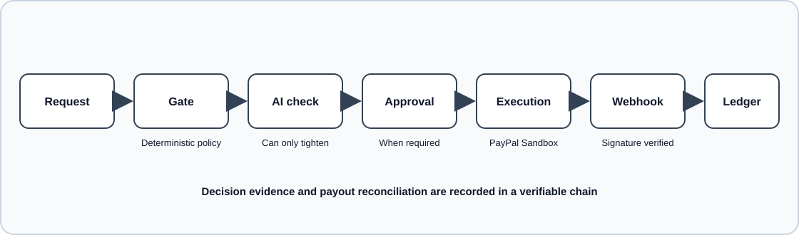

# JOBENPAY

## 1. What it is and the problem

JOBENPAY is a sandbox-only governance layer between AI agents and business payouts. An agent can propose a payment, but it cannot approve or execute one. Deterministic policy checks, invoice signals, human approval where required, and an auditable ledger constrain the path from proposal to payout.

Business email compromise (BEC) targets people through impersonation, invoice fraud, and changes to payment details. Applying those lessons to agents that read documents and can propose payments is an extrapolation, not a measured claim about AI-agent losses. JOBENPAY is intended to complement AP2's agent-payment authorization approach; it is not an AP2 implementation.

## 2. Demo: hosted URL + judge credentials

- Hosted demo: {{HOSTED_URL}}
- Judge account: `judge@jobenpay.test`
- Judge password: {{JUDGE_PASSWORD}}

The project owner must replace these placeholders before publishing a release. Demo data is synthetic, and payment operations are restricted to PayPal Sandbox.

## 3. Run it yourself

Requirements: Node.js 22.13 or newer in the Node 22 line, npm, and Docker Compose.

Start the PostgreSQL service, create a local environment file, and generate local cryptographic keys:

```sh
docker compose up -d postgres
cp .env.example .env
npm run keys:gen >> .env
```

Set `SEED_JUDGE_PASSWORD` in `.env` to a private password of at least 12 characters. For the smoke test, set `JUDGE_SMOKE_PASSWORD` to the same value. Then install, initialize, and start:

```sh
npm ci && npm run setup && npm start
```

`npm run setup` installs the web dependencies, builds the UI, applies database migrations, and seeds synthetic demo data. The default `AI_PROVIDER=replay` needs no AI key. To use a live AI provider, configure its API key, model, and non-zero input/output prices in `.env`. To use PayPal, connect your own PayPal Sandbox credentials in the application settings; do not use live credentials.

To enable self-service signup, set `REGISTRATION_ENABLED=1`, `PUBLIC_BASE_URL` to your HTTPS app URL, and configure your `SMTP_*` credentials (see `.env.example`). Registrations are throttled by `SIGNUP_DAILY_LIMIT` (default 50/day), per-IP (5/hr), and per-email (3/hr). To enable Sign in / Sign up with Google, configure `GOOGLE_CLIENT_ID` with your Google OAuth 2.0 Web Client ID; Google Identity Services will be displayed on the login and signup screens.

In another terminal, run the dry-run judge smoke test:

```sh
node --env-file=.env scripts/judge-smoke.js
```

## 4. How PayPal is used and how AI is used

PayPal is used only through its Sandbox API: OAuth obtains an access token, the Payouts API submits an approved payout with a stable idempotency key, and signed webhooks are verified before payout results are reconciled. The UI is not a PayPal product and does not expose provider credentials to agents or AI.

AI may extract invoice fields, check intent, and parse natural-language mandate drafts. Uploaded text is treated as untrusted data; provider calls receive no tools. AI can only tighten a deterministic decision, never approve a payment. Provider errors or invalid output fail closed to a non-automatic decision.

Provider agreement links and operator review notes are in [docs/third-party-terms.md](docs/third-party-terms.md).

## 5. Architecture

The diagram is also maintained in [docs/architecture.md](docs/architecture.md).



## 6. Security model and honest limits

- The hash-chained ledger and signatures provide evidence of internal record integrity. They do not prove that an operator could not recreate or replace the entire database and its history.
- Approvals and ledger entries are signed by the server; approval signatures are not held by an independent client key.
- The interface follows selected PayPal Business interaction patterns, but JOBENPAY is not a PayPal product. Screens without a supplied reference are marked **INFERRED**; parity there is not independently established.
- This project makes no claim of AP2 compliance or certification.
- AI output is untrusted and cannot override deterministic rejection or approval requirements. PayPal calls are sandbox-only by construction.

See [docs/THREAT_MODEL.md](docs/THREAT_MODEL.md) for threats, controls, and test evidence.

## 7. Built during the submission period

The project was built and expanded across structured phases (F0 through F9):
- **15 Universal Categories (28 Sub-type pairs):** PAYOUT, SALE, REFUND, VOID, PARTIAL, DOWN_PAYMENT, INVOICE, DISPUTE, SCHEDULED, RECURRING, BULK, SPLIT, TRANSFER, FINANCING, and DEBIT.
- **Double-Entry Ledger Architecture:** Every transaction generates strictly balanced debit/credit legs enforced by PostgreSQL DB trigger (`SUM(DEBIT) = SUM(CREDIT)` per currency). Entries are signed with Ed25519 and chained via SHA-256 tamper-evident hashes.
- **Multi-Level Idempotency:** Tenant-scoped `Idempotency-Key` and derived PayPal request IDs (`jp_{intent_id}_{step}`) prevent duplicate executions across network interruptions or worker retries.
- **Staged Decision Policy Engine:** Deterministic rule evaluation (Stages A/B) with monotonic AI tightening (Stage C) where AI can strictly tighten policies (REJECT / REQUIRE_APPROVAL) and is strictly forbidden from loosening decisions.
- **Daily Reconciliation:** Background reconciliation worker (`reconcile_daily`) verifying legs, settlement records, and provider state with automated mismatch detection and freeze alerts.
- **Comprehensive Test Suite:** 919+ automated tests across unit, integration, concurrency, chaos disruptions, security fuzzing, IDOR, AI adversarial evals, and Playwright E2E with 100% green exit code.

## 8. Testing instructions

Run the automated verification suite:

```sh
# Full test suite (919+ tests)
npm test

# Fast unit tests
npm run test:unit

# Architectural and security guards (Sandbox host guard, no-float money lint, insert tests, traceability)
npm run guard
node scripts/lint-no-float-money.js
node scripts/check-traceability.js
node scripts/check-insert-tests.js

# Category Completion Checklist (CCC) verification
node scripts/ccc-check.js PAYOUT
node scripts/ccc-check.js FINANCING
node scripts/ccc-check.js DEBIT

# Automated smoke test for judge account
node --env-file=.env scripts/judge-smoke.js
```

For manual verification on the web UI:
1. Log in with the Judge account (`judge@jobenpay.test`).
2. Navigate to **Transactions** (`/transactions`) to inspect transactions across all 15 categories.
3. Review Double-Entry legs and Suspicious Activity Reports (SAR v1.1) in Transaction Detail.
4. Open **Simulator** (`/simulator`) to run legitimate and adversarial payment flows.
5. Open **Ledger** (`/ledger`) and click **Verify** to execute real-time hash-chain integrity verification.

## 9. What's next

- **Sandbox & Simulation Boundaries:** PayPal operations are strictly restricted to the PayPal Sandbox environment. Tier C categories (`FINANCING` and `DEBIT`) run via the deterministic `PartnerSimulatorProvider` with explicit `[SIMULATED]` labeling and zero external network exposure (see [docs/spec/partner-simulator-limitations.md](docs/spec/partner-simulator-limitations.md)).
- **Internal Ledger Accounting:** As defined in PRD 1.3 §0 and Preamble A.5, escrow, loan, and clearing accounts represent internal book accounts rather than licensed banking escrow or credit facilities.
- **Key Rotation & Disaster Recovery:** Operational runbook for AES-256-GCM and Ed25519 key rotation, point-in-time recovery, and dead-letter queue resolution is documented in [docs/OPERATIONS.md](docs/OPERATIONS.md).
- **API Reference:** Auto-generated from canonical Zod schemas in [docs/API_REFERENCE.md](docs/API_REFERENCE.md).

## 10. License

JOBENPAY is licensed under the [MIT License](LICENSE). Third-party package licenses are listed in [THIRD_PARTY_NOTICES.md](THIRD_PARTY_NOTICES.md).
