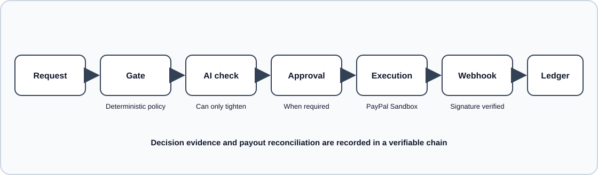

# JOBENPAY

## 1. What it is and the problem

JOBENPAY is a sandbox-only governance layer between AI agents and business payouts. An agent can propose a payment, but it cannot approve or execute one. Deterministic policy checks, invoice signals, human approval where required, and an auditable ledger constrain the path from proposal to payout.

Business email compromise (BEC) targets people through impersonation, invoice fraud, and changes to payment details. Applying those lessons to agents that read documents and can propose payments is an extrapolation, not a measured claim about AI-agent losses. JOBENPAY is intended to complement AP2's agent-payment authorization approach; it is not an AP2 implementation.

## 2. Demo: hosted URL + judge credentials

- Hosted demo: {{HOSTED_URL}}
- Judge account: `judge@jobenpay.test`
- Judge password: {{JUDGE_PASSWORD}}

The project owner must replace these placeholders before publishing a release. Demo data is synthetic, and payment operations are restricted to PayPal Sandbox.

## 3. Run it yourself

Requirements: Node.js 22.13 or newer in the Node 22 line, npm, and Docker Compose.

Start the PostgreSQL service, create a local environment file, and generate local cryptographic keys:

```sh
docker compose up -d postgres
cp .env.example .env
npm run keys:gen >> .env
```

Set `SEED_JUDGE_PASSWORD` in `.env` to a private password of at least 12 characters. For the smoke test, set `JUDGE_SMOKE_PASSWORD` to the same value. Then install, initialize, and start:

```sh
npm ci && npm run setup && npm start
```

`npm run setup` installs the web dependencies, builds the UI, applies database migrations, and seeds synthetic demo data. The default `AI_PROVIDER=replay` needs no AI key. To use a live AI provider, configure its API key, model, and non-zero input/output prices in `.env`. To use PayPal, connect your own PayPal Sandbox credentials in the application settings; do not use live credentials.

In another terminal, run the dry-run judge smoke test:

```sh
node --env-file=.env scripts/judge-smoke.js
```

## 4. How PayPal is used and how AI is used

PayPal is used only through its Sandbox API: OAuth obtains an access token, the Payouts API submits an approved payout with a stable idempotency key, and signed webhooks are verified before payout results are reconciled. The UI is not a PayPal product and does not expose provider credentials to agents or AI.

AI may extract invoice fields, check intent, and parse natural-language mandate drafts. Uploaded text is treated as untrusted data; provider calls receive no tools. AI can only tighten a deterministic decision, never approve a payment. Provider errors or invalid output fail closed to a non-automatic decision.

Provider agreement links and operator review notes are in [docs/third-party-terms.md](docs/third-party-terms.md).

## 5. Architecture

The diagram is also maintained in [docs/architecture.md](docs/architecture.md).



## 6. Security model and honest limits

- The hash-chained ledger and signatures provide evidence of internal record integrity. They do not prove that an operator could not recreate or replace the entire database and its history.
- Approvals and ledger entries are signed by the server; approval signatures are not held by an independent client key.
- The interface follows selected PayPal Business interaction patterns, but JOBENPAY is not a PayPal product. Screens without a supplied reference are marked **INFERRED**; parity there is not independently established.
- This project makes no claim of AP2 compliance or certification.
- AI output is untrusted and cannot override deterministic rejection or approval requirements. PayPal calls are sandbox-only by construction.

See [docs/THREAT_MODEL.md](docs/THREAT_MODEL.md) for threats, controls, and test evidence.

## 7. Built during the submission period

The first project commit is dated October 30, 2026. The submission-period build includes:

- Node.js/Express API, PostgreSQL schema, sessions, tenant isolation, and role-based access.
- Mandates, deterministic payment decisions, invoice upload and extraction, injection checks, approvals, and budget controls.
- PayPal Sandbox payout execution, idempotent recovery, webhook reconciliation, and a verifiable ledger.
- Agent REST and stateless MCP interfaces, synthetic simulator scenarios, and the React web application.
- Security checks, operations tooling, CI workflows, and documentation for local setup and integration.

## 8. Testing instructions

For the hosted demo, use the judge account above:

1. Log in.
2. Open **Simulator**.
3. Select **Run legit invoice**.
4. Select **Run attack pack**.
5. Open **Ledger** and select **Verify**.

These scenarios use synthetic data. The simulator dry-run does not submit a payout.

## 9. What's next

The current submission targets Tier A. Possible Tier B work from the product roadmap includes registration and account recovery, TOTP, refund/dispute workflows, email notifications, CSV export, Indonesian localization, an AG Grid ledger theme, an expanded AI evaluation corpus, and additional MCP tools.

Tier C roadmap items include reminders, a complete email outbox, four-eyes approval, organization deletion, fuller ADMIN/OPERATOR UI permissions, and WebAuthn. These are roadmap items, not claims about delivered functionality.

## 10. License

JOBENPAY is licensed under the [MIT License](LICENSE). Third-party package licenses are listed in [THIRD_PARTY_NOTICES.md](THIRD_PARTY_NOTICES.md).
